<!-- CHICO.OS — perfil de netooochiico | HTML e Markdown compatíveis com o GitHub -->

<p align="center">
  
</p>

<p align="center">
  
</p>

<p align="center">
  <a href="#sobre-mim">SOBRE MIM</a> &nbsp; / &nbsp;
  <a href="#tech-stack">ESTUDOS</a> &nbsp; / &nbsp;
  <a href="#projetos">PROJETOS</a> &nbsp; / &nbsp;
  <a href="#github-analytics">ANALYTICS</a> &nbsp; / &nbsp;
  <a href="#conexoes">CONEXÕES</a>
</p>

<p align="center">
  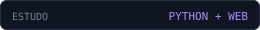
  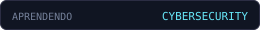
  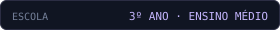
</p>

---

<a id="sobre-mim"></a>
### `01` &nbsp; SOBRE MIM

Sou o **Chico**, de João Pessoa, **estudante do 3º ano do ensino médio**. **Estou aprendendo programação e cibersegurança** e descobrindo, na prática, os caminhos que quero seguir na tecnologia.

Este perfil registra minha evolução: exercícios, projetos de estudo, tentativas e aprendizados. Tenho contato com Python e lógica de programação e estou explorando desenvolvimento web, Linux, redes e segurança. Ainda estou aprendendo — cada projeto é uma oportunidade de praticar e melhorar.

```python
class Chico:
    usuario = "netooochiico"
    escolaridade = "3º ano do ensino médio"
    fase = "Estudante — em aprendizado"
    estudando = ["Python", "Lógica", "Desenvolvimento web"]
    explorando = ["Linux", "Redes", "Cibersegurança"]
    metodo = "Aprender → Praticar → Documentar → Evoluir"
```

<a id="tech-stack"></a>
### `02` &nbsp; TECNOLOGIAS QUE ESTOU APRENDENDO

<p align="center">
   &nbsp;&nbsp;
  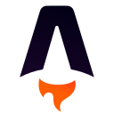 &nbsp;&nbsp;
   &nbsp;&nbsp;
   &nbsp;&nbsp;
  
</p>

<p align="center"><sub>Python · Astro · TypeScript · Git · Linux<br />Estou aprendendo e explorando essas tecnologias. Os ícones não representam domínio profissional.</sub></p>

### `03` &nbsp; FERRAMENTAS QUE ESTOU EXPLORANDO

<p align="center">
   &nbsp;&nbsp;
  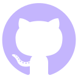 &nbsp;&nbsp;
   &nbsp;&nbsp;
  
</p>

<p align="center"><sub>Aprendendo a usar VS Code, terminal, Git e GitHub nos meus estudos.</sub></p>

---

<a id="projetos"></a>
### `04` &nbsp; PROJETOS DE APRENDIZADO

<p align="center">
  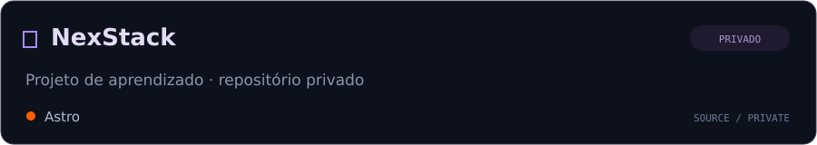
</p>
<p align="center">
  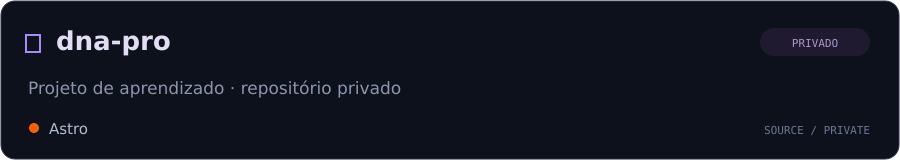
</p>
<p align="center">
  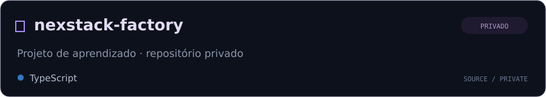
</p>

<p align="center">
  <a href="https://github.com/netooochiico?tab=repositories"><b>EXPLORAR REPOSITÓRIOS PÚBLICOS ↗</b></a><br />
  <sub>Os projetos acima estão privados; o código ainda não está disponível publicamente.</sub>
</p>

### `05` &nbsp; OBJETIVOS ATUAIS

```text
chico@workspace:~$ roadmap --current

[01] Concluir o 3º ano do ensino médio.
[02] Aprender mais Python e lógica com exercícios práticos.
[03] Praticar desenvolvimento web com projetos de estudo.
[04] Explorar Linux, redes e segurança em laboratórios.
[05] Registrar minha evolução e compartilhar aprendizados.

Próxima etapa: transformar estudo em prática consistente.
```

---

<a id="github-analytics"></a>
### `06` &nbsp; GITHUB ANALYTICS

<p align="center">
  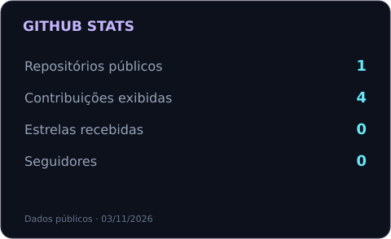
  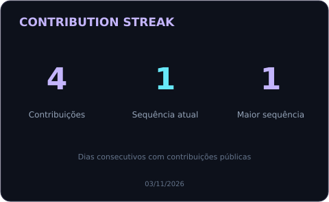
</p>

<p align="center">
  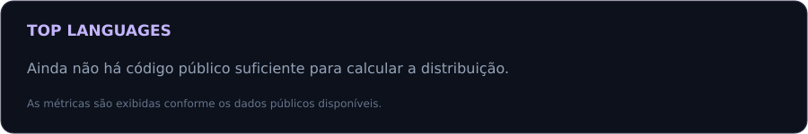
</p>

<p align="center"><sub>Estatísticas baseadas nos dados públicos disponíveis. Top Languages mede código publicado, não nível de domínio.</sub></p>

<p align="center">
  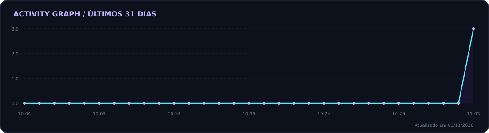
</p>

### `07` &nbsp; GITHUB TROPHIES

<p align="center">
  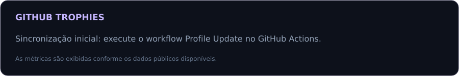
</p>

### `08` &nbsp; CONTRIBUTION SNAKE

<p align="center">
  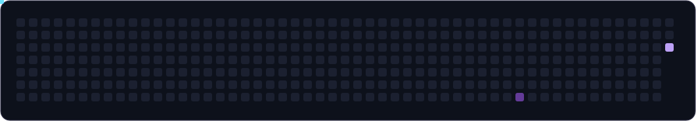
</p>

---

<a id="conexoes"></a>
### `09` &nbsp; CONEXÕES

<p align="center">
  <a href="https://github.com/netooochiico">
    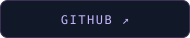
  </a>
  &nbsp;
  <a href="https://github.com/netooochiico?tab=repositories">
    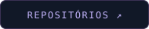
  </a>
</p>

<!-- Redes sociais adicionais: descomente somente depois de inserir seus links reais.
<p align="center">
  <a href="https://www.linkedin.com/in/SEU_USUARIO/"></a>
  <a href="https://www.instagram.com/SEU_USUARIO/"></a>
</p>
-->

<p align="center">
  <b>Curiosidade para explorar. Disciplina para continuar.</b><br />
  <sub>3º ano do ensino médio · Aprendendo programação e cibersegurança.</sub>
</p>

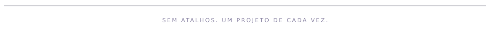
