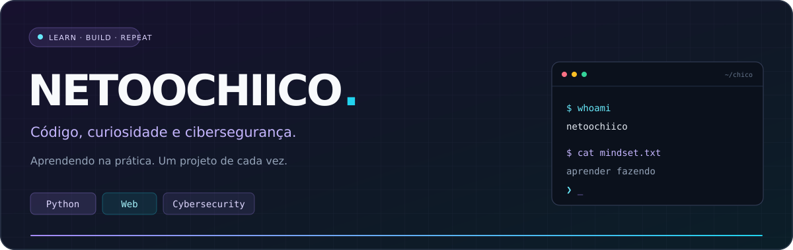

<p align="center">
  
</p>

<p align="center">
  <a href="#sobre-mim">Sobre mim</a> &nbsp;·&nbsp;
  <a href="#minha-trilha">Minha trilha</a> &nbsp;·&nbsp;
  <a href="#laboratorio">Laboratório</a> &nbsp;·&nbsp;
  <a href="https://github.com/netoochiico?tab=repositories">Repositórios</a>
</p>

<a id="sobre-mim"></a>
## 👋 Olá, eu sou o Chico

Gosto de entender como as coisas funcionam — e de aprender colocando a mão no código. Já crio apps e sites, tenho uma base em **Python e lógica de programação** e estou direcionando meus estudos para **cibersegurança**.

Meu objetivo é desenvolver projetos úteis, entender melhor os sistemas por trás deles e aprender a torná-los mais seguros.

```yaml
usuario: netoochiico
local: João Pessoa, PB • Brasil
base: Python e lógica de programação
interesses: [desenvolvimento, cibersegurança, tecnologia]
metodo: aprender → praticar → documentar → melhorar
```


<a id="minha-trilha"></a>
## 🧭 Minha trilha

| Área | Onde estou focando |
| :--- | :--- |
| 🐍 **Programação** | Aprofundar minha base em Python e resolver problemas na prática. |
| 🌐 **Desenvolvimento** | Evoluir na criação de apps e sites com projetos próprios. |
| 🐧 **Linux e redes** | Estudar terminal, permissões e os fundamentos da comunicação entre sistemas. |
| 🛡️ **Cibersegurança** | Praticar em laboratórios autorizados e entender como proteger aplicações. |


<a id="laboratorio"></a>
## 🧪 Laboratório

Estou organizando meus projetos e anotações para compartilhar minha evolução por aqui.

- **Python na prática** — scripts, exercícios e pequenas automações.
- **Apps e sites** — ideias transformadas em projetos funcionais.
- **Estudos de segurança** — anotações e aprendizados de ambientes de treinamento.

[**Explorar meus repositórios →**](https://github.com/netoochiico?tab=repositories)

<details>
<summary><b>💭 Como eu gosto de aprender</b></summary>

<br />

Entender o problema, construir uma primeira versão, testar e melhorar. Aprendo mais quando consigo relacionar a teoria com algo que fiz funcionar.

</details>


<p align="center">
  <b>Curiosidade para explorar. Disciplina para continuar.</b><br />
  <sub>Construindo meu caminho em tecnologia, um projeto de cada vez.</sub>
</p>
